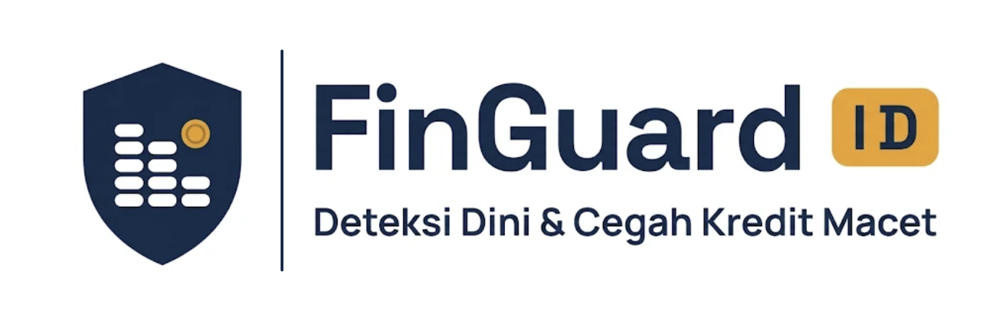
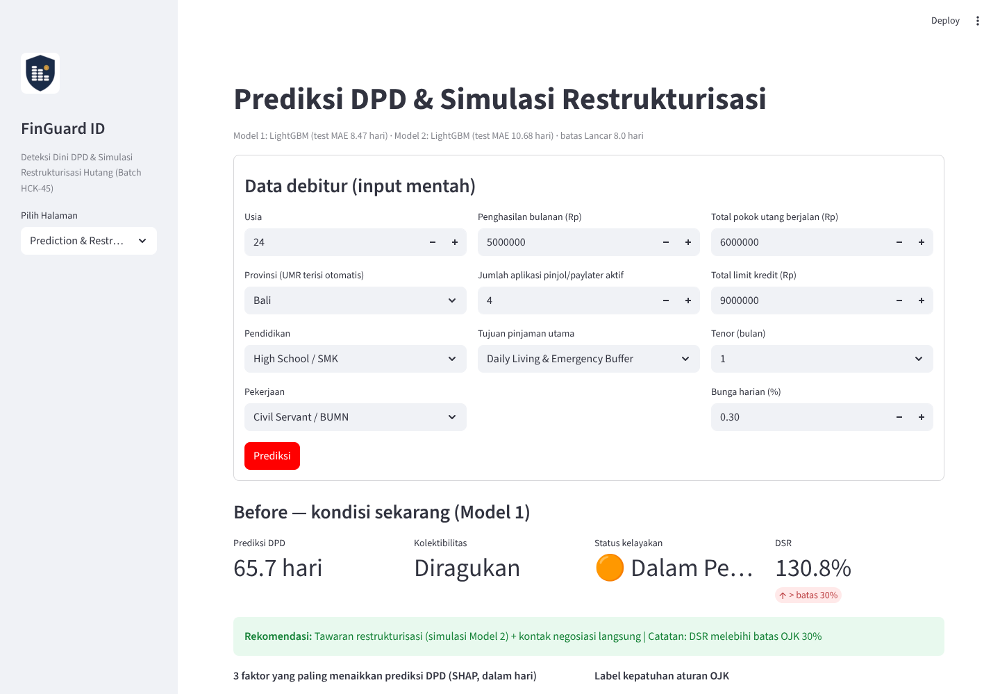
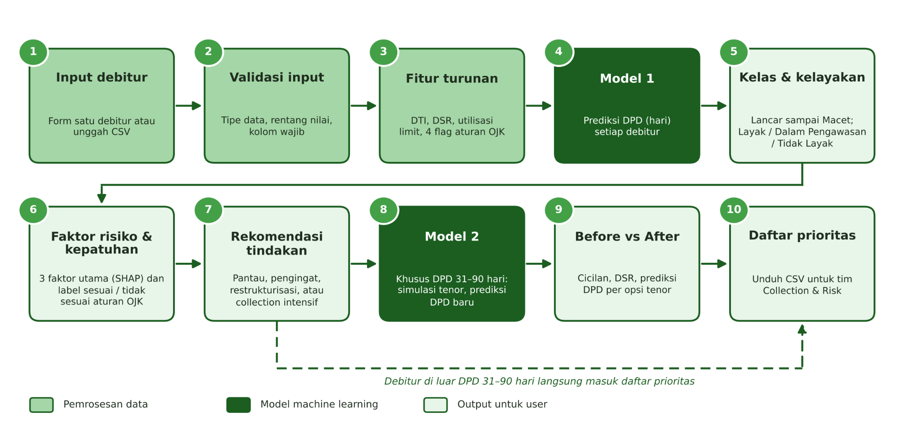
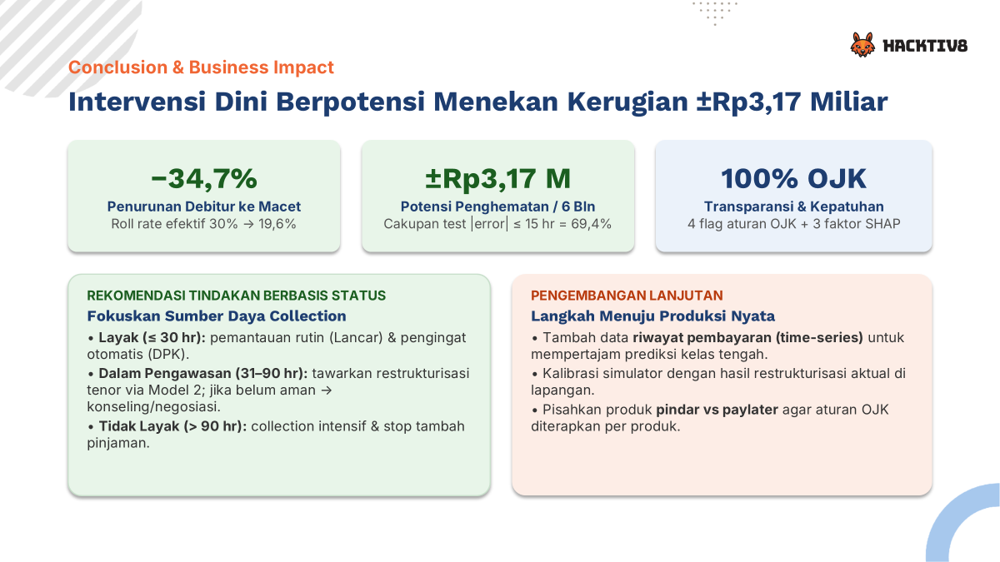
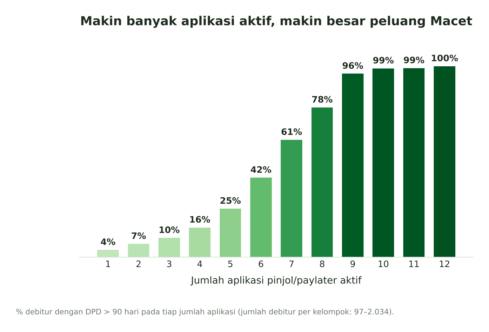
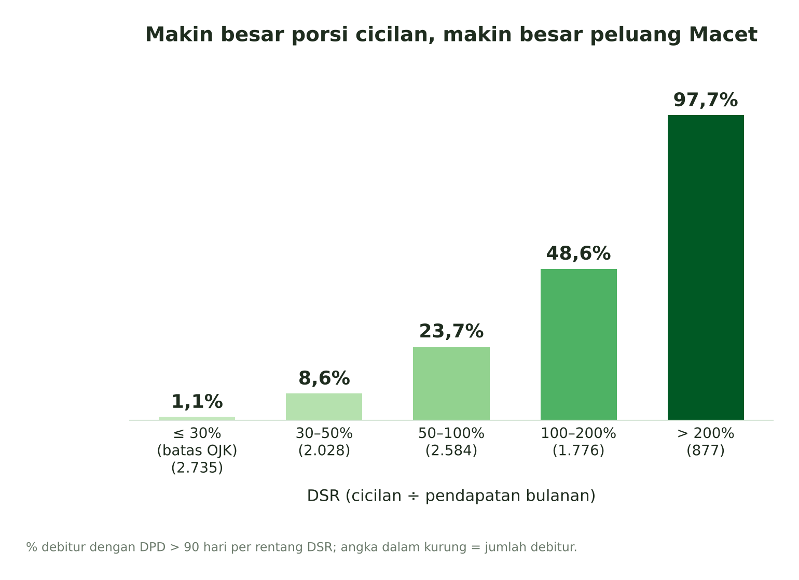

<p align="center">
  
</p>

# FinGuard ID — Early-Warning Kolektibilitas Debitur Pindar & Paylater

**Early-Warning Kolektibilitas Debitur Pindar & Paylater berbasis estimasi Days Past Due (DPD) dengan dua model regresi dan simulasi restrukturisasi Before vs After**

Final Project Hacktiv8 Full-Time Data Science (FTDS) · **Batch HCK-045** · Project kelompok (3 orang)

**Aplikasi:** https://finguardid.streamlit.app

> **English summary.** An early-warning app for Indonesian online lending (*pindar*) and paylater portfolios. Instead of classifying default, it **regresses days past due (DPD, 0–180)** with LightGBM and maps the estimate to the five OJK collectibility classes. A second LightGBM model, trained only on delinquent borrowers, simulates restructuring options (tenor 3–24 months) until the debt-service ratio is ≤ 30% and predicted DPD ≤ 30 days. On a 2,000-borrower test set: **MAE 8.47 days, R² 0.957, recall on *Macet* (> 90 days) 0.945**, with a fairness gap of only 0.01 days (gender) and 1.07 days (occupation). Delivered as a Streamlit app plus a local Airflow → Elasticsearch → Kibana batch-scoring pipeline.



## Tim & Kontribusi

| Anggota | Peran |
|---|---|
| Rizqullah Anjar Pradana | Data Engineer |
| **Baihaqsani** | **Data Scientist** |
| Alyssa Putri Azahra | Data Analyst |

**Kontribusi saya (Baihaqsani):**
- Mencari dan mengusulkan topik project (early-warning kolektibilitas debitur pindar & paylater), lalu menyusun dan mengajukan proposal.
- **Modeling Model 1 (Kelayakan) dan Model 2 (Restrukturisasi):** pemilihan dan perbandingan model dengan cross validation, hyperparameter tuning, serta evaluasi MAE/RMSE/R² dan recall Macet.
- **Evaluasi fairness:** memastikan selisih MAE antar gender dan jenis pekerjaan tetap di bawah batas 5 hari.

Acuan: `Final_Project_Proposal_FinGuardID.pdf`

---

## Repository Outline
```text
1.  README.md                                - Dokumentasi utama proyek, hasil evaluasi, cara menjalankan, & preview dashboard
2.  Final_Project_Proposal_FinGuardID.pdf    - Proposal Final Project (Dual Regression)
3.  features.py                              - Modul bersama: rasio, 4 flag OJK, max_principal_ojk, pemetaan DPD, simulasi & SHAP
4.  modeling.ipynb                           - Notebook utama (Bab 1–9): EDA DPD, Audit VIF < 10, Model 1 & Model 2, Fairness
5.  inference.ipynb                          - Notebook uji 5 kasus + cek konsistensi Model 1 vs Model 2 + batch test
6.  sync_artifacts.py                        - Skrip sinkronisasi features.py & artefak model ke deployment/ dan pipeline/
7.  requirements.txt & packages.txt          - Dependensi Python (pin versi h8_env) & libgomp1 untuk Streamlit Community Cloud
8.  assets/                                  - Logo utama (finguard_logo.png) & ikon aplikasi (finguard_icon.png)
9.  dataset/                                 - Dataset mentah Kaggle (10.000 baris x 26 kolom)
10. model/                                   - model_kelayakan.pkl, model_restrukturisasi.pkl, model_metadata.json, test_ids.csv, umr_reference.json
11. deployment/                              - Aplikasi Streamlit untuk hosting di streamlit.app (requirements.txt + src/)
12. pipeline/                                - Pipeline Docker lokal: airflow_ES.yaml, README_AIRFLOW.md, ddl.sql, dags/, gx_validation.ipynb
13. images/                                  - Screenshot aplikasi & grafik pendukung README
```

---

## Problem Background
Kualitas kredit industri pinjaman daring (pindar) nasional mengalami tekanan: OJK mencatat **TWP90 industri pindar mencapai 5,36% per September 2026**, melewati batas aman 5% dan naik dari 2,82% pada September 2025, dengan dominasi *outstanding* bermasalah pada usia 19–34 tahun (48,22%). Sejalan dengan itu, OJK memberlakukan batas rasio cicilan pindar konsumtif maksimal **30% dari penghasilan sejak 2026 (SEOJK 19/SEOJK.06/2025)**.

FinGuard ID dirancang sebagai showcase aplikasi peringatan dini yang dapat diadopsi oleh penyelenggara pindar/paylater maupun pemangku kepentingan terkait (disimulasikan pada portofolio 10.000 debitur). Tanpa alat untuk memperkirakan **berapa hari debitur berjalan akan menunggak (DPD)** dan **skema restrukturisasi apa yang layak**, tim Collection & Risk cenderung baru melakukan intervensi intensif setelah debitur jatuh ke kredit macet (DPD > 90 hari).

---

## Project Output
1. **Dua Model Regresi (`model_kelayakan.pkl` & `model_restrukturisasi.pkl`):**
   - **Model 1 (`model_kelayakan.pkl` — LightGBM):** Dilatih pada seluruh `X_train` (8.000 baris) untuk memprediksi `days_past_due` (0–180 hari) dan memetakannya ke 5 kelas kolektibilitas OJK (batas Lancar hasil CV = **8,0 hari**) serta 3 status kelayakan (`Layak`, `Dalam Pengawasan`, `Tidak Layak`).
   - **Model 2 (`model_restrukturisasi.pkl` — LightGBM):** Dilatih khusus pada debitur menunggak (`DPD > 0`, 5.194 baris) untuk menyimulasikan perubahan DPD *After* pada perpanjangan tenor 3–24 bulan dengan batas bunga OJK hingga memenuhi **DSR ≤ 30% dan prediksi DPD ≤ 30 hari**.
2. **Aplikasi Demo Online (`deployment/` di `streamlit.app`):** Menyajikan halaman **EDA + Audit VIF**, **Prediction & Restrukturisasi (Before vs After)** dengan faktor SHAP & 4 flag kepatuhan OJK, serta **Batch CSV**.
3. **Automated Local ETL & Batch Scoring Pipeline (`pipeline/`):** Stack lokal Docker (`airflow_ES.yaml`) berisi PostgreSQL 13, Apache Airflow 2.3.4 (`FinGuard_ID_DAG`), Great Expectations 0.18.19 (10/10 expectations lulus 100%), Elasticsearch 7.13.0, dan Kibana 7.13.0.

### Alur Aplikasi


---

## Ringkasan Hasil Evaluasi (Data Test, n = 2.000)
| Objective | Target | Hasil Aktual (Test) | Status |
|---|---|---|---|
| Model 1 — Prediksi Kelayakan | MAE ≤ 10, RMSE ≤ 15 hari | **MAE 8,47 hari** · **RMSE 12,29 hari** · **R² 0,957** (CV: 8,37) | ✅ |
| Model 2 — Restrukturisasi (DPD > 0, n = 1.298) | MAE ≤ 12 hari | **MAE 10,68 hari** · **RMSE 13,95 hari** · **R² 0,940** (CV: 10,60) | ✅ |
| Mengalahkan Baseline | < Dummy & Linear Regression | M1: Dummy 50,25 · LinReg 13,06 \| M2: Dummy 49,52 · LinReg 15,55 | ✅ |
| Recall Macet (Prediksi > 90 hari) | ≥ 0,90 | **0,945 (94,5%)** · Akurasi ±1 kelas **99,4%** · Kelayakan **90,2%** | ✅ |
| Audit Multikolinearitas (VIF) | Seluruh fitur < 10 | **VIF maks 6,01** (13 fitur numerik & flag) | ✅ |
| Fairness Audit (Selisih MAE) | Gender & Pekerjaan ≤ 5 hari | **Gender 0,01 hari** · **Pekerjaan 1,07 hari** | ✅ |
| Kepatuhan 4 Aturan OJK | 100% debitur berlabel | **100%** | ✅ |
| Ilustrasi Dampak Bisnis 6 Bulan | Penurunan ≥ 35% / ±Rp3,20 M | **−34,7% / Rp3,17 M** (cakupan test `|error| ≤ 15 hari` = 69,4%) | ≈ *(ilustrasi)* |

* **Simulasi Before vs After (409 debitur test prediksi DPD 31–90 hari):** Rata-rata prediksi DPD turun **55,7 → 24,8 hari**, DSR turun **91% → 24%**, **78,7%** (322 debitur) menemukan opsi tenor aman (terbanyak 6–9 bulan), dan 21,3% memerlukan penanganan lain (hanya 7 debitur yang butuh potongan pokok `max_principal_ojk`, median 5,8%).



---

## Data & Batasan
Dataset: [Indonesia Fintech P2P Lending & Paylater 2026 — Kaggle (CC0)](https://www.kaggle.com/datasets/luthfimuthathohirin/indonesia-fintech-p2p-lending-paylater-default) (`10.000 baris × 26 kolom`).

* **4 kolom generatif LLM dibuang seluruhnya** (`twp90_default_status`, `primary_default_root_cause`, `cot_financial_psychology_rationale`, `confidence_score`); target regresi memakai **`days_past_due` (0–180 hari)**.
* **Batasan:** Cara pengukuran `days_past_due` tidak didokumentasikan dan disebut persis di narasi LLM dataset asli (kemungkinan dibuat dalam proses yang sama); data bersifat *snapshot* tanpa tanggal untuk usia **18–35 tahun**; porsi Macet 25,4% dari debitur (40,5% dari *outstanding*, ±7,5× TWP90 industri); dataset tidak memisahkan kolom produk pindar vs paylater.

### Temuan EDA Utama
- **Multi-borrowing adalah sinyal risiko kuat:** porsi Macet naik dari 4% (1 aplikasi aktif) menjadi hampir 100% (9 aplikasi ke atas).
- **Beban cicilan lebih menentukan daripada penghasilan:** pada DSR ≤ 30% (batas OJK) hanya 1,1% debitur yang Macet, sedangkan di atas 200% mencapai 97,7%.

| | |
|---|---|
|  |  |

---

## Cara Menjalankan

### 1. Menjalankan Notebook & Sinkronisasi Artefak (Lokal `h8_env`)
```bash
pip install -r requirements.txt
# Jalankan Restart & Run All pada modeling.ipynb dan inference.ipynb
python sync_artifacts.py
```

### 2. Menjalankan & Hosting Aplikasi Streamlit (`streamlit.app`)
* **Lokal:**
  ```bash
  cd deployment/src
  streamlit run streamlit_app.py
  ```
* **Hosting di Streamlit Community Cloud (`share.streamlit.io`):**
  1. Hubungkan repositori GitHub ini ke `share.streamlit.io`.
  2. Isi **Main file path:** `deployment/src/streamlit_app.py`.
  3. Di **Advanced settings**, pilih **Python version: `3.11`** (sudah diuji berjalan; Python 3.9 tidak lagi didukung untuk app baru di Streamlit Community Cloud). Versi library tetap di-pin agar cocok dengan `model_kelayakan.pkl` dan `model_restrukturisasi.pkl` (`scikit-learn==1.6.1`, `lightgbm==4.6.0`). File `packages.txt` di root otomatis memasang `libgomp1` untuk LightGBM.

### 3. Menjalankan Pipeline Airflow, PostgreSQL, Elasticsearch & Kibana (Lokal Docker)
Seluruh langkah setup container lokal (`pipeline/airflow_ES.yaml`), pemuatan `ddl.sql`, trigger DAG `FinGuard_ID_DAG`, dan pembuatan dashboard Kibana tersedia lengkap di **[pipeline/README_AIRFLOW.md](pipeline/README_AIRFLOW.md)**.

---

## Dashboard Kibana (Lokal)
Dashboard Kibana dijalankan secara lokal di atas stack Docker (`pipeline/airflow_ES.yaml`) sebagai bagian dari batch scoring pipeline, sehingga tidak ditampilkan sebagai demo online. Langkah membuat index pattern dan dashboard tersedia di **[pipeline/README_AIRFLOW.md](pipeline/README_AIRFLOW.md)**.

---

## Stacks
- **Bahasa Pemrograman & Analisis:** Python 3.9 (training), Python 3.11 (deployment), SQL (PostgreSQL)
- **Machine Learning & Explainability:** `scikit-learn==1.6.1`, `lightgbm==4.6.0`, `shap==0.49.1`, `statsmodels`, `pandas==2.3.3`, `numpy==1.26.4`
- **Deployment Demo:** Streamlit Community Cloud (`streamlit.app`)
- **Data Pipeline & Visualisasi Lokal:** Docker Compose (`pipeline/airflow_ES.yaml`), PostgreSQL 13, Apache Airflow 2.3.4, Great Expectations 0.18.19, Elasticsearch 7.13.0, Kibana 7.13.0

---

## Reference
- **Dataset:** [Indonesia Fintech P2P Lending & Paylater 2026 — Kaggle](https://www.kaggle.com/datasets/luthfimuthathohirin/indonesia-fintech-p2p-lending-paylater-default)
- **OJK:** [SEOJK Nomor 19/SEOJK.06/2025 tentang Penyelenggaraan LPBBTI](https://ojk.go.id/id/regulasi/Pages/SEOJK-19-SEOJK06-2025-Penyelenggaraan-LPBBTI.aspx) & [Siaran Pers OJK SP 214 (LPBBTI & BNPL)](https://ojk.go.id/id/berita-dan-kegiatan/siaran-pers/Documents/Pages/LPBBTI-dan-BNPL/SP%20214%20-%20LPBBTI%20dan%20BNPL.pdf)
- **Bisnis.com (5/11/2026):** [Kredit Pinjol Capai Rp106,48 Triliun per September 2026, TWP90 Tembus 5,36%](https://finansial.bisnis.com/read/20261105/563/2018798/kredit-pinjol-capai-rp10648-triliun-per-september-2026-twp90-tembus-536)
- **Bisnis.com (13/7/2026):** [OJK Atur Batas Usia dan Penghasilan Pengguna Paylater (PADK 2/2026)](https://finansial.bisnis.com/read/20260713/563/1987617/ojk-atur-batas-usia-dan-penghasilan-pengguna-paylater-demi-perkuat-kualitas-pembiayaan)
- **BCA Sekuritas (15/9/2026):** [OJK: Batas Pendanaan Maksimal Tiga Pindar Tidak Jadi Diberlakukan](https://bcasekuritas.co.id/latest-news/news/ojk-batas-pendanaan-maksimal-tiga-pindar-tidak-jadi-diberlakukan)
